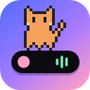

<p align="center"></p>

# Pixel Island — 윈도우용 다이내믹 아일랜드

화면 맨 위에 떠 있는 작은 섬에서 음악, 알림, 제어 센터, 캘린더를 다루고, 그 위에서 도트 캐릭터가 뛰어노는 윈도우 앱입니다. 섬의 모양과 캐릭터는 테마로 자유롭게 꾸밀 수 있습니다.

## 설치

**[DynamicIslandSetup.exe 내려받기](https://github.com/ranodadge/pixel-island/releases/latest/download/DynamicIslandSetup.exe)** (64비트 윈도우 10 버전 2004 이상 / 윈도우 11)

1. 내려받은 파일을 더블클릭하고 "예"를 누르면 설치됩니다. 관리자 권한과 .NET 설치는 필요 없습니다.
2. 서명이 없는 파일이라 "Windows의 PC 보호" 경고가 뜰 수 있습니다. "추가 정보 → 실행"을 누르면 진행됩니다.
3. 설치 후에는 시작 메뉴나 윈도우 검색에서 `Dynamic Island`로 실행합니다.

제거는 설정 → 앱 → 설치된 앱에서 하거나, 꾸미기 창의 앱 설정 탭에서 합니다. 만들어 둔 테마와 설정은 제거해도 남습니다.

## 기능

- **음악**: 재생 중인 곡의 제목·앨범 그림·진행 막대, 재생/일시정지/이전/다음, 소리에 반응하는 비주얼라이저
- **알림**: 윈도우 알림을 섬에서 표시
- **제어 센터**: Wi-Fi·블루투스 켜기/끄기, 볼륨, 화면 밝기, CPU·메모리·배터리 게이지
- **연결 목록**: Wi-Fi 네트워크 선택과 비밀번호 입력, 블루투스 오디오 기기 연결, 소리 출력 장치 전환
- **캘린더**: 달력, 한국 공휴일 표시, 날짜별 메모
- **기본 상태**: 시계와 CPU·메모리 사용량, 배터리 잔량(배터리가 있는 기기)
- **테마 꾸미기**: 색·그라데이션·테두리·글로우·모서리, 흩날리는 장식, 공 장난감
- **도트 캐릭터**: 고양이·슬라임·유령·병아리·로봇, 16×16 도트 직접 그리기, 사진을 넣으면 자동으로 도트 캐릭터로 변환
- **기타**: 윈도우 시작 시 자동 실행, 잠금 해제 연출(Windows Hello와 함께 사용), 전체 화면에서 숨기기

## 사용법

- 섬에 마우스를 올리거나 클릭하면 펼쳐집니다. 우클릭하면 제어 센터가 열립니다.
- 제어 센터의 시계를 누르면 캘린더가 열립니다.
- 트레이 아이콘을 더블클릭하거나, 앱이 켜진 상태에서 바로가기를 다시 누르면 꾸미기 창이 열립니다.

## 데이터와 개인 정보

- 테마·설정·캘린더 메모는 이 PC의 `%AppData%\DynamicIsland`에만 저장됩니다.
- 앱은 어떤 정보도 외부로 보내지 않습니다. 비주얼라이저는 스피커로 나가는 소리의 크기만 읽고 저장하지 않습니다.

## 알려진 제한

- 잠긴 화면을 실제로 푸는 일은 윈도우(Windows Hello)가 합니다. 앱은 잠금이 풀릴 때 연출만 보여 줍니다.
- 블루투스 연결/해제는 오디오 기기만 지원합니다. 새 기기 페어링과 회사·학교용(엔터프라이즈) Wi-Fi는 윈도우 설정에서 해야 합니다.
- 공휴일에는 대체공휴일·임시공휴일·선거일이 포함되지 않습니다.

## 직접 빌드하기

[.NET 9 SDK](https://dotnet.microsoft.com/download)가 필요합니다.

```
dotnet build -c Release
```

| 스크립트 | 하는 일 |
| --- | --- |
| `make-setup.ps1` | 런타임까지 포함한 단일 설치파일 `dist\DynamicIslandSetup.exe`를 만듭니다. |
| `release.ps1 -Version 1.1.0` | 버전을 올리고, 설치파일을 만들고, 커밋·태그·푸시한 뒤 GitHub 릴리스에 설치파일을 올립니다. |

WPF(.NET 9)로 만들었고, [NAudio](https://github.com/naudio/NAudio)를 사용합니다.

---

이 프로젝트는 Apple과 관련이 없는 개인 프로젝트입니다. "Dynamic Island"는 Apple Inc.의 상표입니다.
